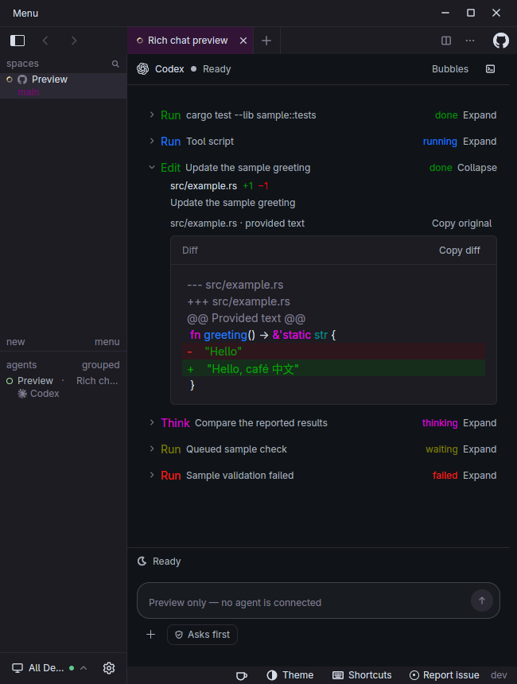
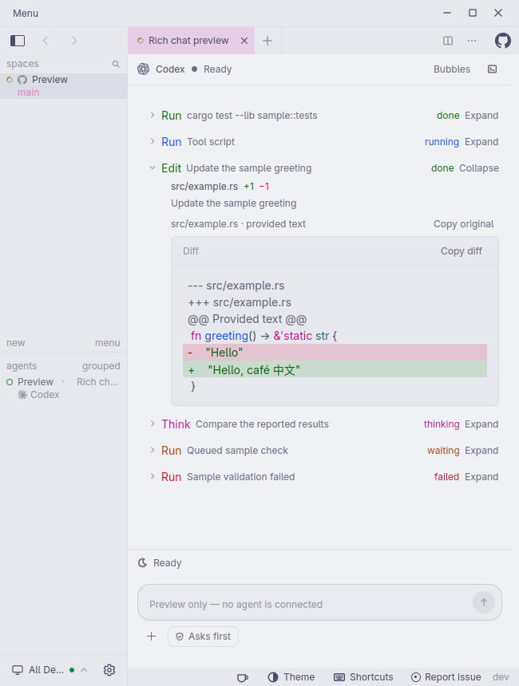
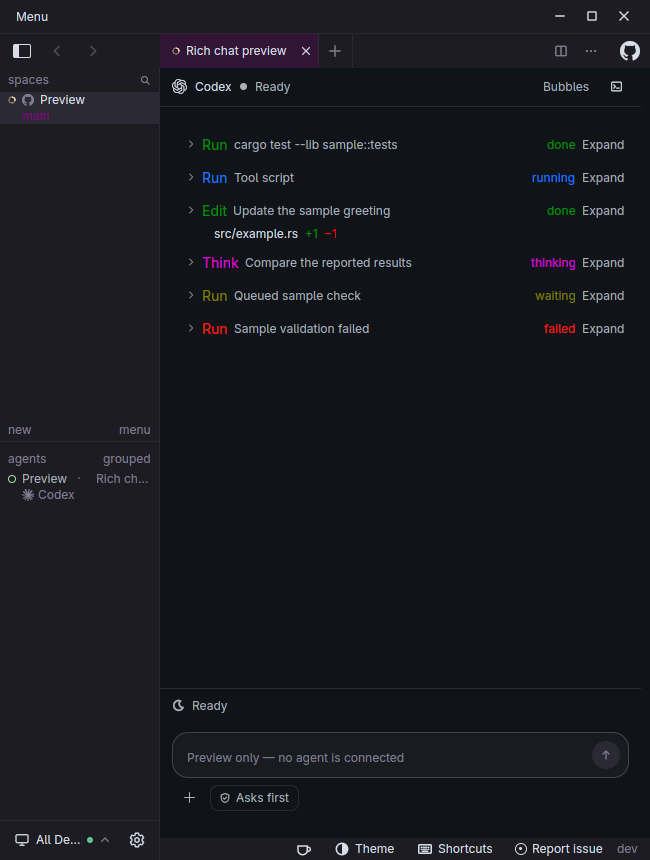
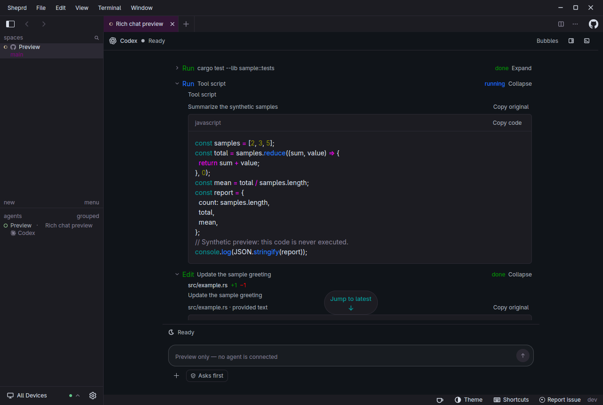
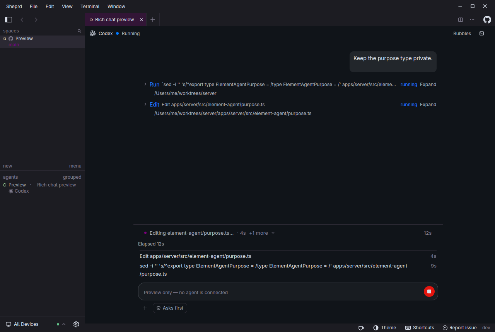
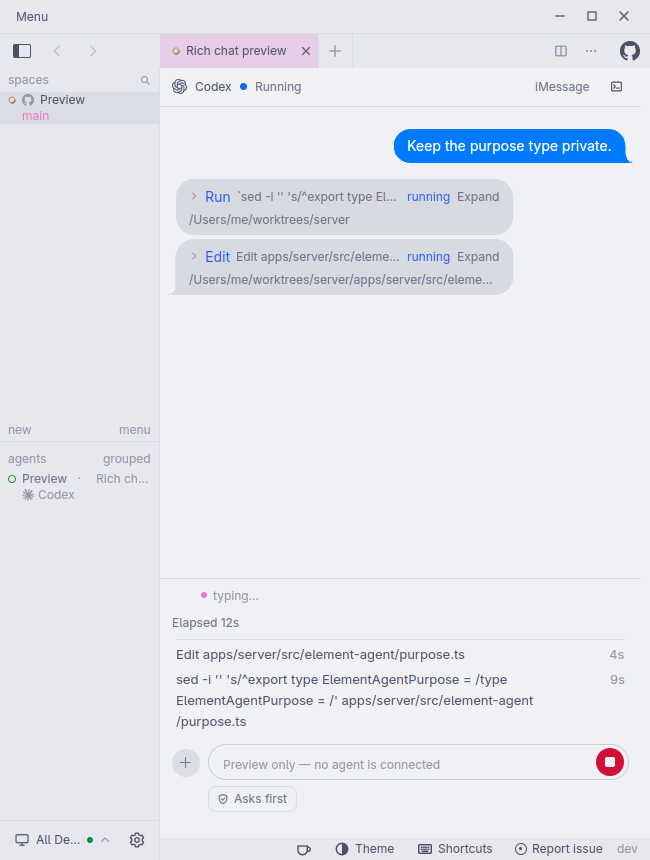

# PR #812: current native UI captures

Captured from public PR commit `b8d3b2ae5d2e3a11c8fdef33c63ae3c819376b0b` after the upstream integration. The fixtures use synthetic sample transcripts.

The working-step list, step clocks, and iMessage typing cue come from upstream; these captures show how the tool rendering and reading controls fit alongside them. The tool showcase deliberately combines several tool states while the sample session is Ready.

[Source and capture provenance](provenance.json) records the binary, driver, and image hashes. The five isolated native cases passed, including real disclosure and jump-button clicks. These captures do not establish connected-provider or cross-platform behavior.

## Expanded tool diff, dark narrow layout

## Expanded tool diff, light narrow layout

## Same tool after a real disclosure click

## Highlighted command output and centered jump control while reading earlier content

## Upstream running-step descriptions and clocks, with the shared activity strip

## Native iMessage typing cue and running steps in a narrow light layout

